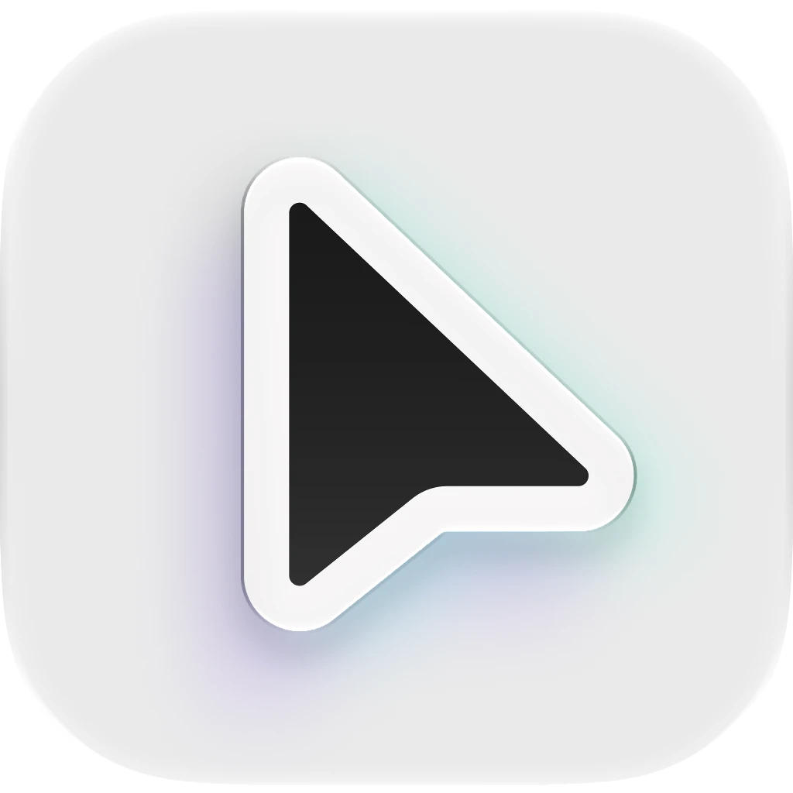

# JoyMouse



A tiny macOS menu bar app that turns a **Nintendo Switch 2 Joy-Con** into a mouse.
Slide the Joy-Con 2 on your desk and its built-in optical sensor moves the
pointer; its buttons click, scroll, and press keys. Every button can be remapped
from the menu.

## Features

- **Optical pointer**: uses the Joy-Con 2's mouse sensor, smoothed to your
  display's refresh rate (120 Hz on ProMotion).
- **Default layout**: R = left click, ZR = right click (L / ZL on a left
  Joy-Con). A = Return, B = Escape, X = Mission Control, Y = Space, stick press =
  middle click, SL / SR = Back / Forward. The stick scrolls.
- **Remap anything** from the menu: clicks, double click, scrolling, a
  slow-pointer "precision" button, ⌘Tab, Mission Control, common keys, arrows.
- **Reconnects on its own**: after the first sync, press any button on a
  sleeping Joy-Con and it comes back in about a second.
- **Battery friendly**: disconnects after a few idle minutes (configurable) so
  the Joy-Con can sleep; optional Battery Saver connection. Shows battery
  level and the Joy-Con's own colour.
- Lightweight: a few hundred KB, no windows, no Dock icon.

## Install

With [Homebrew](https://brew.sh):

```sh
brew tap myles-dean/tap
brew trust myles-dean/tap
brew install --cask myles-dean/tap/joymouse
```

Or by hand:

1. Download `JoyMouse-<version>.dmg` from the [Releases](../../releases/latest) page.
2. Open it and drag **JoyMouse** into **Applications**, then open it from there.

Either way, the first time it opens: allow **Bluetooth** when asked, and allow
**Accessibility** in System Settings → Privacy & Security → Accessibility
(needed to move the pointer and click).

Requires macOS 14 or later.

## Use

1. Click the pointer icon in the menu bar and choose **Sync Joy-Con 2…**.
2. Hold the small sync button on the Joy-Con's rail. The menu bar icon blinks
   while it searches and stays filled once a Joy-Con is connected.
3. Slide the Joy-Con on a surface like a mouse.

If the pointer moves the wrong way, use **Pointer → Sensor Direction**.
**Show Log** in the menu opens `~/Library/Logs/JoyMouse.log`.

Only one app can use a Joy-Con at a time, so quit JoyMouse before using the
Joy-Con with another app or game.

## Build from source

```sh
./build.sh               # build/JoyMouse.app, ad-hoc signed (or SIGN_IDENTITY="...")
./release.sh             # universal, Developer ID signed + notarized DMG (see the script)
```

Needs Xcode's command line tools (Swift 5.9+). No Xcode project, no dependencies.

## Credits

- The Joy-Con 2 Bluetooth protocol code is adapted from
  [WaveBird](https://github.com/murphyjt/wavebird) by Joshua Murphy (MIT).
  If you want to use Switch 2 controllers as gamepads on a Mac, use WaveBird.
- Protocol research by [ndeadly](https://github.com/ndeadly/switch2_controller_research),
  plus [SDL](https://github.com/libsdl-org/SDL) and
  [BlueRetro](https://github.com/darthcloud/BlueRetro). See
  [THIRD_PARTY_NOTICES.md](THIRD_PARTY_NOTICES.md).
- Built with the help of [Claude Code](https://claude.com/claude-code).

JoyMouse is not affiliated with or endorsed by Nintendo. Joy-Con and Nintendo
Switch are trademarks of Nintendo.

## License

MIT, see [LICENSE](LICENSE).
